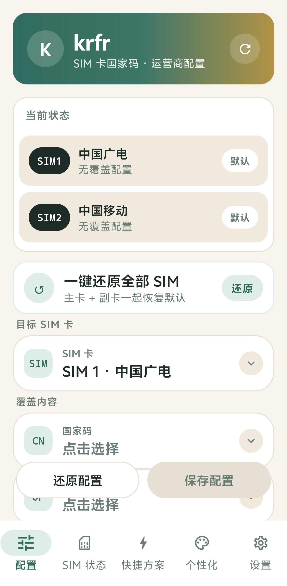

<div align="center">

# 📶 krfr

### SIM 卡国家码与运营商配置工具 · 免 Root · 基于 Shizuku


[](https://github.com/kinsonstudio/krfr/releases/latest)
[](https://github.com/kinsonstudio/krfr/releases)
[](LICENSE)
[](https://github.com/kinsonstudio/krfr)
[](https://github.com/RikkaApps/Shizuku)

**双卡独立配置 · SIM 实时状态 · 快捷方案 · 备份恢复 · 主题切换**

</div>

---

## 📥 下载

> 点击下方按钮，跳转到官网下载页或 GitHub Releases 下载最新版本

<div align="center">

### [🌐 前往官网下载页下载](https://taiai.asia/krfr.html)

### [🚀 前往 GitHub Releases 下载](https://github.com/kinsonstudio/krfr/releases/latest)

</div>

## ✨ 功能亮点

| | 功能 | 说明 |
|---|---|---|
| 🌍 | **国家码修改** | 经 Shizuku 修改 SIM 卡国家码（MCC/MNC）与运营商名称，双卡独立覆盖，支持自定义值 |
| 📡 | **SIM 实时状态** | 每张卡的网络类型、信号强度、MCC/MNC、国家/地区、漫游状态、ICCID（脱敏）实时可查 |
| ⚡ | **快捷方案** | 18 个常用「国家码 + 运营商」组合，选定 SIM 一键应用 |
| 💾 | **备份与恢复** | 当前所有卡槽的覆盖配置导出为 JSON，换机 / 重装后一键恢复 |
| 🎨 | **主题切换** | 应用内自由切换 浅色纸感墨绿 / 深色暖墨 主题 |
| 🔄 | **检查更新** | 内置更新检测，直接对接 GitHub Releases |

## 📱 应用截图

<div align="center">



<br/>

*配置页 · 双卡独立配置国家码与运营商（SIM1 中国广电 / SIM2 中国移动）*

</div>

## 🚀 快速开始

1. 安装并启动 **[Shizuku](https://github.com/RikkaApps/Shizuku)**（无线调试或 ADB 方式激活）
2. 下载安装 krfr APK（需允许「安装未知来源应用」）
3. 打开 krfr，按引导完成 Shizuku 授权
4. 选择 SIM 卡 → 修改国家码 / 运营商 → 保存
5. 重启手机或等待配置生效

## 🛠 从源码构建

### 环境要求

- Android Studio（Koala 或更新）
- **JDK 21**（Gradle 8.9 不支持 JDK 25）
- Android SDK

### 命令行构建

```bash
cd krfr
ANDROID_HOME=$HOME/Library/Android/sdk JAVA_HOME=$HOME/jdk21/Contents/Home ./gradlew :app:assembleDebug
```

APK 输出：`app/build/outputs/apk/debug/app-debug.apk`

> 若环境存在 `ANDROID_SDK_ROOT` 且指向错误路径，先 `unset ANDROID_SDK_ROOT`，避免与 `ANDROID_HOME` 冲突。

## 📁 项目结构

```
app/src/main/java/com/github/krfr/
├── data/          # 预设数据：国家码、运营商、快捷方案、设置持久化
├── manager/       # 核心逻辑：CarrierConfig 覆盖、SIM 状态读取、备份恢复、更新检测
├── ui/
│   ├── components/  # 公共组件（渐变页头、状态徽章、结果横幅等）
│   ├── screens/     # 配置 / SIM 状态 / 快捷方案 / 设置 / 关于
│   ├── theme/       # 主题色板与切换
│   └── MainScaffold.kt  # 底部导航容器
└── MainActivity.kt
```

## 🧩 技术栈

- **Kotlin + Jetpack Compose**（Material 3）
- **Shizuku**（`rikka.shizuku:api:13.1.5`）+ HiddenApiBypass，全程免 Root
- 包名 `com.github.krfr` · 版本 v1.0.0
- minSdk 26 / targetSdk 35 / compileSdk 36

## 📄 许可证

本项目基于 **[Ackites/Nrfr](https://github.com/Ackites/Nrfr)** 开发，遵循 **Apache-2.0** 许可证。

上游许可证：[Ackites/Nrfr LICENSE](https://github.com/Ackites/Nrfr/blob/master/LICENSE)

## ⚠️ 免责声明

本工具仅供学习研究。修改运营商配置可能影响网络、漫游与区域识别，请自行承担使用风险。

---

<div align="center">

**Made by [KinsonStudio](https://github.com/kinsonstudio)** · 独立开发 · 基于 Nrfr 开源

</div>
