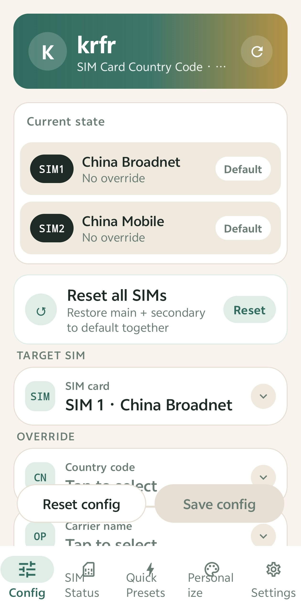
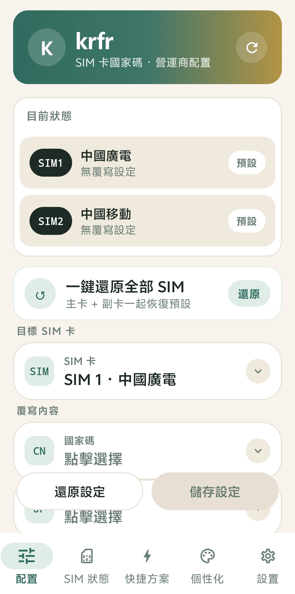

<div align="center">

# 📶 krfr

### SIM Card MCC/MNC & Carrier Configuration Tool · No Root · Powered by Shizuku


[](https://github.com/kinsonstudio/krfr/releases/latest)
[](https://github.com/kinsonstudio/krfr/releases)
[](LICENSE)
[](https://github.com/kinsonstudio/krfr)
[](https://github.com/RikkaApps/Shizuku)

</div>

---

<div align="center">

### 🌐 Language / 语言

**English** · [简体中文](#zh-cn) · [繁體中文](#zh-tw)

</div>

> **Tip:** New users get a language picker right after Shizuku authorization — it auto-matches your device system language (English by default). You can switch anytime in the app's Personalize tab.

---

<a id="en"></a>

## 🇬🇧 English

### 📥 Download

> Tap a button below to get the latest version from the official download page or GitHub Releases

<div align="center">

### [🌐 Go to Official Download Page](https://taiai.asia/krfr.html)

### [🚀 Go to GitHub Releases](https://github.com/kinsonstudio/krfr/releases/latest)

</div>

### ✨ Features

| | Feature | Description |
|---|---|---|
| 🌍 | **MCC/MNC Override** | Change SIM card country code (MCC/MNC) and carrier name via Shizuku, per-SIM independent override with custom values |
| 📡 | **Live SIM Status** | Network type, signal strength, MCC/MNC, country/region, roaming state, masked ICCID for every SIM in real time |
| ⚡ | **Quick Presets** | 18 common "country code + carrier" combos, apply to any SIM with one tap |
| 💾 | **Backup & Restore** | Export all override configs as JSON; restore after switching devices or reinstalling |
| 🎨 | **Personalize** | 4 color themes (dark green / ocean blue / warm orange / rose), light & dark modes, upload your own background image |
| 🪪 | **SIM Display Name** | Edit each SIM's display name (status bar card name) with one-tap restore to default |
| 🌐 | **Trilingual UI** | English / 简体中文 / 繁體中文 — all interface texts localized; auto-matches system language on first launch |
| 🔄 | **Update Check** | Built-in update checker backed by a fast domestic server (GitHub API as fallback) |

### 📱 Screenshots

<div align="center">



<br/>

*Config screen · per-SIM independent country code & carrier override (SIM1 China Broadnet / SIM2 China Mobile)*

</div>

### 🚀 Quick Start

1. Install and activate **[Shizuku](https://github.com/RikkaApps/Shizuku)** (via wireless debugging or ADB)
2. Download and install the krfr APK (allow "install unknown apps")
3. Open krfr, pick your language (auto-matched to system, English default), then follow the wizard to grant Shizuku permission
4. Select a SIM → change MCC/MNC or carrier name → save
5. Reboot the device or wait for the config to take effect

### 🛠 Build from Source

**Requirements:** Android Studio (Koala or newer) · **JDK 17** (Gradle 8.9 does not support JDK 25) · Android SDK

```bash
cd krfr
export JAVA_HOME=$HOME/jdk17/Contents/Home
./gradlew :app:assembleRelease
```

APK output: `app/build/outputs/apk/release/app-release.apk`

> If `ANDROID_SDK_ROOT` points to a wrong path, run `unset ANDROID_SDK_ROOT` first to avoid conflicts with `ANDROID_HOME`.

### 📁 Project Structure

```
app/src/main/java/com/github/krfr/
├── data/          # Preset data: country codes, carriers, quick presets, settings persistence
├── manager/       # Core logic: CarrierConfig override, SIM status, backup/restore, update check
├── ui/
│   ├── components/  # Shared components (gradient headers, status badges, result banners…)
│   ├── screens/     # Config / SIM status / Quick presets / Settings / About / Personalize
│   ├── theme/       # Theme palettes & switching
│   └── MainScaffold.kt  # Bottom navigation container
└── MainActivity.kt
```

### 🧩 Tech Stack

- **Kotlin + Jetpack Compose** (Material 3)
- **Shizuku** (`rikka.shizuku:api:13.1.5`) + HiddenApiBypass, fully rootless
- Package `com.github.krfr` · Latest version v1.0.9
- minSdk 26 / targetSdk 35 / compileSdk 36

### 📄 License

This project is developed based on **[Ackites/Nrfr](https://github.com/Ackites/Nrfr)** under the **Apache-2.0** license.

Upstream license: [Ackites/Nrfr LICENSE](https://github.com/Ackites/Nrfr/blob/master/LICENSE)

### ⚠️ Disclaimer

This tool is for learning and research purposes only. Modifying carrier configuration may affect network, roaming and region detection. Use at your own risk.

<div align="center">

**[简体中文](#zh-cn)** · **[繁體中文](#zh-tw)** · **[⬆ Back to top](#en)**

</div>

---

<a id="zh-cn"></a>

## 🇨🇳 简体中文

### 📥 下载

> 点击下方按钮，从官网下载页或 GitHub Releases 获取最新版本

<div align="center">

### [🌐 前往官网下载页下载](https://taiai.asia/krfr.html)

### [🚀 前往 GitHub Releases 下载](https://github.com/kinsonstudio/krfr/releases/latest)

</div>

### ✨ 功能亮点

| | 功能 | 说明 |
|---|---|---|
| 🌍 | **国家码修改** | 经 Shizuku 修改 SIM 卡国家码（MCC/MNC）与运营商名称，双卡独立覆盖，支持自定义值 |
| 📡 | **SIM 实时状态** | 每张卡的网络类型、信号强度、MCC/MNC、国家/地区、漫游状态、ICCID（脱敏）实时可查 |
| ⚡ | **快捷方案** | 18 个常用「国家码 + 运营商」组合，选定 SIM 一键应用 |
| 💾 | **备份与恢复** | 当前所有卡槽的覆盖配置导出为 JSON，换机 / 重装后一键恢复 |
| 🎨 | **个性化** | 4 套配色主题（墨绿 / 海蓝 / 暖橙 / 玫红）、明暗模式、上传图片作为应用背景 |
| 🪪 | **SIM 显示名** | 可修改每张 SIM 卡的显示名（状态栏卡名），支持一键还原默认 |
| 🌐 | **三语界面** | 英文 / 简体中文 / 繁體中文，全部界面文字本地化，首次进入自动匹配系统语言 |
| 🔄 | **检查更新** | 内置更新检测，优先走国内服务器（GitHub API 自动兜底） |

### 📱 应用截图

<div align="center">


<br/>

*配置页 · 双卡独立配置国家码与运营商（SIM1 中国广电 / SIM2 中国移动）*

</div>

### 🚀 快速开始

1. 安装并启动 **[Shizuku](https://github.com/RikkaApps/Shizuku)**（无线调试或 ADB 方式激活）
2. 下载安装 krfr APK（需允许「安装未知来源应用」）
3. 打开 krfr，选择语言（自动匹配系统语言，默认英文），按引导完成 Shizuku 授权
4. 选择 SIM 卡 → 修改国家码 / 运营商 → 保存
5. 重启手机或等待配置生效

### 🛠 从源码构建

**环境要求：** Android Studio（Koala 或更新）· **JDK 17**（Gradle 8.9 不支持 JDK 25）· Android SDK

```bash
cd krfr
export JAVA_HOME=$HOME/jdk17/Contents/Home
./gradlew :app:assembleRelease
```

APK 输出：`app/build/outputs/apk/release/app-release.apk`

> 若环境存在 `ANDROID_SDK_ROOT` 且指向错误路径，先 `unset ANDROID_SDK_ROOT`，避免与 `ANDROID_HOME` 冲突。

### 📁 项目结构

```
app/src/main/java/com/github/krfr/
├── data/          # 预设数据：国家码、运营商、快捷方案、设置持久化
├── manager/       # 核心逻辑：CarrierConfig 覆盖、SIM 状态读取、备份恢复、更新检测
├── ui/
│   ├── components/  # 公共组件（渐变页头、状态徽章、结果横幅等）
│   ├── screens/     # 配置 / SIM 状态 / 快捷方案 / 设置 / 关于 / 个性化
│   ├── theme/       # 主题色板与切换
│   └── MainScaffold.kt  # 底部导航容器
└── MainActivity.kt
```

### 🧩 技术栈

- **Kotlin + Jetpack Compose**（Material 3）
- **Shizuku**（`rikka.shizuku:api:13.1.5`）+ HiddenApiBypass，全程免 Root
- 包名 `com.github.krfr` · 最新版本 v1.0.9
- minSdk 26 / targetSdk 35 / compileSdk 36

### 📄 许可证

本项目基于 **[Ackites/Nrfr](https://github.com/Ackites/Nrfr)** 开发，遵循 **Apache-2.0** 许可证。

上游许可证：[Ackites/Nrfr LICENSE](https://github.com/Ackites/Nrfr/blob/master/LICENSE)

### ⚠️ 免责声明

本工具仅供学习研究。修改运营商配置可能影响网络、漫游与区域识别，请自行承担使用风险。

<div align="center">

**[English](#en)** · **[繁體中文](#zh-tw)** · **[⬆ 回到顶部](#zh-cn)**

</div>

---

<a id="zh-tw"></a>

## 🇭🇰 繁體中文

### 📥 下載

> 點擊下方按鈕，從官網下載頁或 GitHub Releases 取得最新版本

<div align="center">

### [🌐 前往官網下載頁下載](https://taiai.asia/krfr.html)

### [🚀 前往 GitHub Releases 下載](https://github.com/kinsonstudio/krfr/releases/latest)

</div>

### ✨ 功能亮點

| | 功能 | 說明 |
|---|---|---|
| 🌍 | **國家碼修改** | 經 Shizuku 修改 SIM 卡國家碼（MCC/MNC）與電訊商名稱，雙卡獨立覆蓋，支援自訂值 |
| 📡 | **SIM 實時狀態** | 每張卡的網絡類型、訊號強度、MCC/MNC、國家/地區、漫遊狀態、ICCID（脫敏）實時可查 |
| ⚡ | **快捷方案** | 18 個常用「國家碼 + 電訊商」組合，選定 SIM 一鍵套用 |
| 💾 | **備份與還原** | 當前所有卡槽的覆蓋配置匯出為 JSON，換機 / 重裝後一鍵還原 |
| 🎨 | **個人化** | 4 套配色主題（墨綠 / 海藍 / 暖橙 / 玫紅）、明暗模式、上傳圖片作為應用程式背景 |
| 🪪 | **SIM 顯示名稱** | 可修改每張 SIM 卡的顯示名稱（狀態欄卡名），支援一鍵還原預設 |
| 🌐 | **三語介面** | 英文 / 简体中文 / 繁體中文，全部介面文字本地化，首次進入自動匹配系統語言 |
| 🔄 | **檢查更新** | 內建更新檢測，優先走國內伺服器（GitHub API 自動兜底） |

### 📱 應用截圖

<div align="center">



<br/>

*配置頁 · 雙卡獨立配置國家碼與電訊商（SIM1 中國廣電 / SIM2 中國移動）*

</div>

### 🚀 快速開始

1. 安裝並啟動 **[Shizuku](https://github.com/RikkaApps/Shizuku)**（無線調試或 ADB 方式啟用）
2. 下載安裝 krfr APK（需允許「安裝未知來源應用」）
3. 開啟 krfr，選擇語言（自動匹配系統語言，預設英文），按引導完成 Shizuku 授權
4. 選擇 SIM 卡 → 修改國家碼 / 電訊商 → 儲存
5. 重新啟動手機或等待配置生效

### 🛠 從原始碼建置

**環境要求：** Android Studio（Koala 或更新）· **JDK 17**（Gradle 8.9 不支援 JDK 25）· Android SDK

```bash
cd krfr
export JAVA_HOME=$HOME/jdk17/Contents/Home
./gradlew :app:assembleRelease
```

APK 輸出：`app/build/outputs/apk/release/app-release.apk`

> 若環境存在 `ANDROID_SDK_ROOT` 且指向錯誤路徑，先 `unset ANDROID_SDK_ROOT`，避免與 `ANDROID_HOME` 衝突。

### 📁 專案結構

```
app/src/main/java/com/github/krfr/
├── data/          # 預設資料：國家碼、電訊商、快捷方案、設定持久化
├── manager/       # 核心邏輯：CarrierConfig 覆蓋、SIM 狀態讀取、備份還原、更新檢測
├── ui/
│   ├── components/  # 共用元件（漸變頁頭、狀態徽章、結果橫幅等）
│   ├── screens/     # 配置 / SIM 狀態 / 快捷方案 / 設定 / 關於 / 個人化
│   ├── theme/       # 主題色板與切換
│   └── MainScaffold.kt  # 底部導覽容器
└── MainActivity.kt
```

### 🧩 技術棧

- **Kotlin + Jetpack Compose**（Material 3）
- **Shizuku**（`rikka.shizuku:api:13.1.5`）+ HiddenApiBypass，全程免 Root
- 套件名稱 `com.github.krfr` · 最新版本 v1.0.9
- minSdk 26 / targetSdk 35 / compileSdk 36

### 📄 授權條款

本專案基於 **[Ackites/Nrfr](https://github.com/Ackites/Nrfr)** 開發，遵循 **Apache-2.0** 授權。

上游授權：[Ackites/Nrfr LICENSE](https://github.com/Ackites/Nrfr/blob/master/LICENSE)

### ⚠️ 免責聲明

本工具僅供學習研究。修改電訊商配置可能影響網絡、漫遊與地區識別，請自行承擔使用風險。

<div align="center">

**[English](#en)** · **[简体中文](#zh-cn)** · **[⬆ 回到頂部](#zh-tw)**

</div>

---

<div align="center">

**Made by [KinsonStudio](https://github.com/kinsonstudio)** · 基於 Nrfr 開源 · Apache-2.0

</div>
